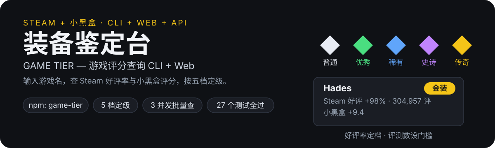
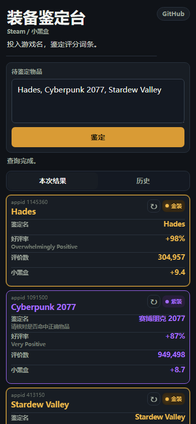

<p align="right"><a href="README.md">中文</a></p>

<p align="center">
  
</p>

<p align="center">
  <a href="https://game-rating-lookup.xiaosang.cc/">▶ Try Online</a>
  ·
  <a href="https://www.npmjs.com/package/game-tier">npm: game-tier</a>
  ·
  <a href="https://github.com/holynova/game-rating-lookup">GitHub Repository</a>
</p>

Look up a game's Steam review score and Xiaoheihe rating, graded into five tiers (white, green, blue, purple, gold). Three forms: a mobile-first web app, an npm CLI, and an open query API.

## Screenshot

<p align="center">
  
</p>

## Tiers

Tiered by Steam positive rate; when Steam data is missing, the Xiaoheihe score ×10 is used instead. Legendary and Epic have review-count thresholds:

| Tier | Grade | Condition |
|---|---|---|
| 🟡 Legendary | gold | Positive rate ≥95% and ≥500 reviews |
| 🟣 Epic | purple | Positive rate ≥85% and ≥50 reviews |
| 🔵 Rare | blue | Positive rate ≥75% |
| 🟢 Good | green | Positive rate ≥60% |
| ⚪ Common | white | Everything else, or no rating found |

## Web

- Mobile-first: enter one or many game names (comma, semicolon, or newline separated); batch queries are not capped, and run 3 at a time in a queue.
- Query history lives in the browser's localStorage and can be filtered by tier; the rating source can be switched between Steam and Xiaoheihe.
- Batch results show each game's Steam positive rate, review count, and Xiaoheihe score right on the page.

## CLI

```bash
npm install -g game-tier
# or run without installing
npx game-tier Hades
```

```bash
game-tier Hades "Elden Ring" "Cyberpunk 2077"   # look up several at once
game-tier --file games.txt --limit 3            # read game names from a file, one per line
game-tier --json Hades                          # output raw JSON
game-tier --refresh Hades                       # ignore cache and re-query
game-tier --no-cache Hades                      # don't read or write cache this time
game-tier history --grade gold                  # filter history by tier
game-tier cache clear                           # clear the cache
```

| Flag | Description |
|---|---|
| `--file <path>` / `-f` | Read game names from a text file |
| `--json` | Output raw JSON |
| `--refresh` | Ignore cache and re-query |
| `--no-cache` | Don't read or write cache |
| `--no-color` | Disable terminal colors |
| `--limit <number>` | Batch query limit, unlimited by default |
| `--help` / `-h` | Show help |

Results are cached by default at `~/.cache/game-tier/results.json` (`$XDG_CACHE_HOME` takes precedence); the `history` command reads this same cache. The API base URL can be overridden with the `GAME_TIER_API_BASE` environment variable.

## API

```
GET https://game-rating-lookup.holynova.workers.dev/api/ratings?q=Hades
GET https://game-rating-lookup.holynova.workers.dev/        # health check
```

- Queries must be at least 2 characters; the response returns `query`, `matched` (identified name + appid), `steam` (positive rate, review count), `heybox` (Xiaoheihe score), `errors`, and `fetchedAt`.
- The two sources are queried independently, so one failing does not affect the other; CORS is open, so it can be called directly from a browser.

## Matching

- Steam: Chinese / CN-region store search, with an exact-title match boost and penalties for demo / DLC / soundtrack results, so lookups don't land on side content.
- Xiaoheihe: matched by Steam appid first (most accurate), by game name when no appid is available.
- Obscure games may be mismatched — trust the returned `matched.name` as the identified title.

## Run Locally

Zero runtime dependencies, Node ≥ 18:

```bash
npm ci
npm test            # 27 tests, node --test
npm run dev         # node server.js, local web server
```

## Tech

- Pure Node.js, no runtime dependencies; the CLI and the web app share the same lookup and tiering logic (`src/core/`).
- The API queries the Steam store search and review endpoints and the Xiaoheihe search endpoint directly, returning live results with no server-side caching.
- The CLI queries the API remotely, with a curl fallback retry on failure.

```
bin/game-tier.js        CLI entry point
src/cli/                CLI: remote query / curl fallback / local cache
src/core/ratings.js     Steam + Xiaoheihe lookup and match scoring
src/core/format.js      Tier mapping and batch parsing
public/                 Web app (Game Tier)
worker.js               API: /api/ratings and health check
server.js               Local development server
test/                   27 tests (node --test)
```

Current version v1.0.1.

## License

MIT License, see [LICENSE](./LICENSE).
