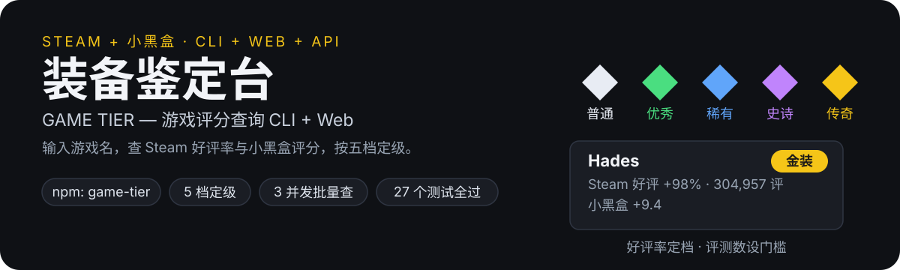
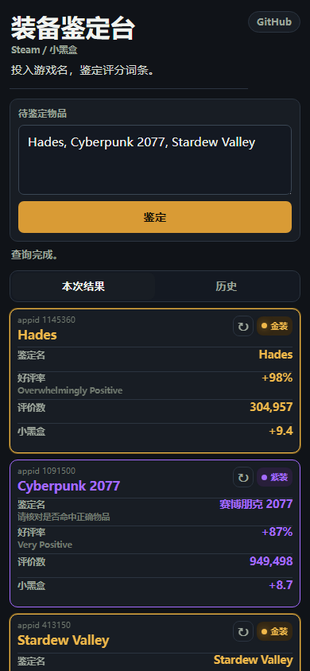

<p align="right"><a href="README.en.md">English</a></p>

<p align="center">
  
</p>

<p align="center">
  <a href="https://game-rating-lookup.xiaosang.cc/">▶ 在线体验</a>
  ·
  <a href="https://www.npmjs.com/package/game-tier">npm: game-tier</a>
  ·
  <a href="https://github.com/holynova/game-rating-lookup">GitHub 仓库</a>
</p>

输入游戏名，查 Steam 好评率与小黑盒评分，按白、绿、蓝、紫、金五档定级。三种形态：移动端优先的 Web 页、npm 命令行工具、开放的查询 API。

## 截图

<p align="center">
  
</p>

## 档位

以 Steam 好评率定档；无 Steam 数据时用小黑盒评分 ×10。传奇与史诗有评测数门槛：

| 档位 | 等级 | 条件 |
|---|---|---|
| 🟡 传奇 | gold | 好评率 ≥95% 且评测数 ≥500 |
| 🟣 史诗 | purple | 好评率 ≥85% 且评测数 ≥50 |
| 🔵 稀有 | blue | 好评率 ≥75% |
| 🟢 优秀 | green | 好评率 ≥60% |
| ⚪ 普通 | white | 其余，或查不到评分 |

## Web 版

- 移动端优先：输入一个或多个游戏名（逗号、分号、换行分隔），批量查询不截断数量，3 个并发排队执行。
- 查询历史存在浏览器 localStorage，可按档位筛选；评分来源可在 Steam 与小黑盒之间切换。
- 批量查询结果可直接在页面查看每款游戏的 Steam 好评率、评测数与小黑盒评分。

## 命令行

```bash
npm install -g game-tier
# 或不安装直接运行
npx game-tier Hades
```

```bash
game-tier Hades "Elden Ring" "Cyberpunk 2077"   # 一次查多个
game-tier --file games.txt --limit 3            # 从文件读游戏名，每行一个
game-tier --json Hades                          # 输出原始 JSON
game-tier --refresh Hades                       # 忽略缓存重新查询
game-tier --no-cache Hades                      # 本次不读写缓存
game-tier history --grade gold                  # 按档位筛选历史
game-tier cache clear                           # 清空缓存
```

| 参数 | 说明 |
|---|---|
| `--file <path>` / `-f` | 从文本文件读取游戏名 |
| `--json` | 输出原始 JSON |
| `--refresh` | 忽略缓存并重新查询 |
| `--no-cache` | 不读取或写入缓存 |
| `--no-color` | 禁用终端颜色 |
| `--limit <number>` | 批量查询上限，默认不限制 |
| `--help` / `-h` | 显示帮助 |

查询结果默认缓存到 `~/.cache/game-tier/results.json`（`$XDG_CACHE_HOME` 优先），`history` 命令查看的就是这份缓存。API 地址可用环境变量 `GAME_TIER_API_BASE` 覆盖。

## API

```
GET https://game-rating-lookup.holynova.workers.dev/api/ratings?q=Hades
GET https://game-rating-lookup.holynova.workers.dev/        # 健康检查
```

- 查询至少 2 个字符；返回 `query`、`matched`（鉴定名与 appid）、`steam`（好评率、评测数）、`heybox`（小黑盒评分）、`errors`、`fetchedAt`。
- 两个数据源独立查询，一方失败不影响另一方；CORS 开放，可直接在浏览器调用。

## 匹配逻辑

- Steam：中文、国区商店搜索，标题精确匹配加权，demo / DLC / 原声带类结果扣权，避免查到附属内容。
- 小黑盒：优先按 Steam appid 匹配（最准），无 appid 时按游戏名匹配。
- 冷门游戏可能误配，请以返回的 `matched.name` 鉴定名为准。

## 本地运行

零运行时依赖，Node ≥ 18：

```bash
npm ci
npm test            # 27 个测试，node --test
npm run dev         # node server.js，本地起 Web 服务
```

## 技术

- 纯 Node.js，无运行时依赖；CLI 与 Web 共用同一套查询与定级逻辑（`src/core/`）。
- API 直查 Steam 商店搜索与评价接口、小黑盒搜索接口，实时返回，不做服务端缓存。
- CLI 远程查 API，失败时用 curl 兜底重试一次。

```
bin/game-tier.js        CLI 入口
src/cli/                CLI：远程查询 / curl 兜底 / 本地缓存
src/core/ratings.js     Steam + 小黑盒查询与匹配打分
src/core/format.js      档位映射与批量解析
public/                 Web 应用（装备鉴定台）
worker.js               API：/api/ratings 与健康检查
server.js               本地开发服务器
test/                   27 个测试（node --test）
```

当前版本 v1.0.1。

## 许可

MIT License，见 [LICENSE](./LICENSE)。
